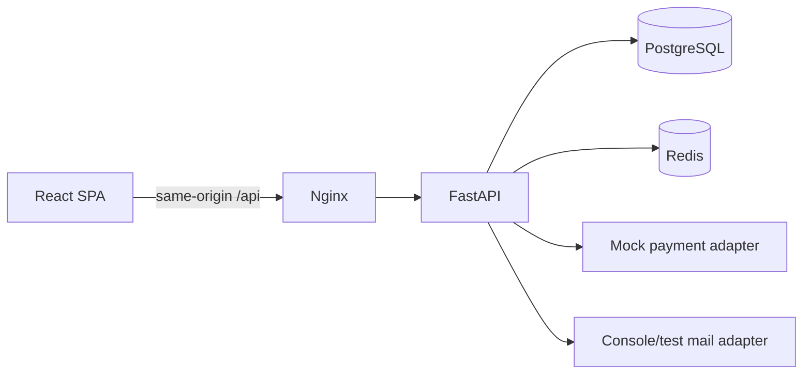

# Backend Architecture

## Goals and boundaries

The backend is the authority for users, catalog publication, variant prices, inventory, carts, orders, payment state and administrative permissions. The browser handles presentation and non-authoritative interaction state. FastAPI routes validate/serialize HTTP requests, domain services enforce workflows, repositories isolate persistence, and integration adapters encapsulate payment, mail, Redis and future AI providers.

## Proposed runtime

No task worker is included initially: email delivery is a local safe sink and mock payment is synchronous. Add a worker only for verified retryable asynchronous jobs. Redis is justified for shared auth throttling and bounded catalog caching; it is never authoritative for stock/orders.

## Modules

- `core`: validated settings, security primitives, logging, request IDs and exceptions.
- `api/v1`: routers and dependency wiring; no business rules.
- `db`: async engine/session and Alembic environment.
- `models` / `schemas`: persistence mappings and explicit external contracts.
- `repositories`: SQL queries and transaction-scoped persistence.
- `domains`: focused user, catalog, inventory, cart, order, payment and admin services.
- `integrations`: mock payment, safe email sink, Redis and optional AI providers.
- `tests`: unit, API and database-backed integration tests.

## Request and transaction behavior

Use async SQLAlchemy 2 sessions per request. A service owns the transaction boundary for multi-row business operations. Catalog list responses can be cached briefly in Redis and invalidated on admin writes. Cart/order totals are calculated from database variant prices. Checkout locks or conditionally updates inventory rows, writes reservation/order/order items/payment intent atomically, and returns explicit pending payment state. Repeated checkout/payment requests use idempotency keys.

## API conventions

Version under `/api/v1`. Use UUID resource identifiers, stable response schemas, UTC ISO timestamps, bounded pagination, allow-listed sorting and validated filters. Errors use a consistent `code`, `message`, optional `fields`, and `request_id` shape. Never return SQL/traceback/configuration details.

## Auth/security

Passwords use Argon2id. Access JWTs are short lived; opaque refresh tokens are random, stored only as hashes, rotated on use and revocable per session. Browser access tokens stay in memory; refresh uses an HttpOnly, Secure-in-production, SameSite cookie scoped to auth endpoints. Enforce role/permission checks in API dependencies. Use normalized unique emails, login throttling via Redis, request size limits, strict input schemas and same-origin proxy defaults. Admin status returns only allow-listed health states and sanitized warnings.

## Integration boundaries

- Payments: provider interface plus local deterministic sandbox adapter; no card data collected or stored.
- Email: interface plus local console/test sink; provider setup requires owner-supplied credentials.
- Storage: current product photography is shipped as static assets; upload service is omitted until admin-managed uploads are required.
- AI: optional provider interface; no configured provider means an explicit unavailable/degraded response. AI cannot authoritatively set price, stock, payment or permissions.

## Observability and testing

Emit structured logs with request IDs and safe identifiers; redact authorization/cookie/password/secret fields. `/api/health` checks process liveness, `/api/ready` checks required dependencies and migrations, and admin status reports sanitized per-dependency state. Test services with unit tests, API behavior with HTTPX, persistence/migrations against PostgreSQL in Compose, Redis rate limiting/cache against Redis, and user journeys in Playwright.
