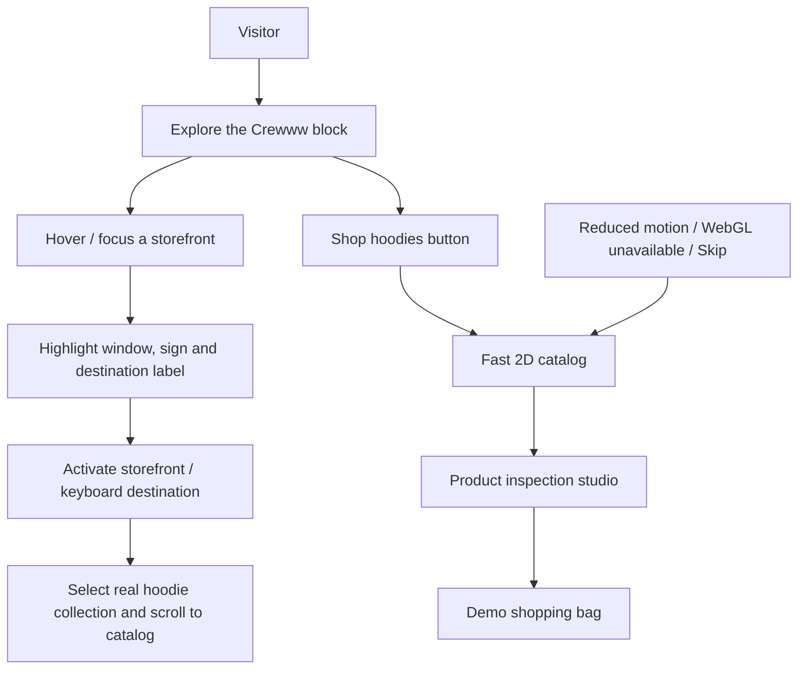

# Crewww Digital Fashion World — Stage Plan

## Creative direction

Build an original Crewww fashion world with the feel of a cinematic, walkable fashion district. Use a restrained forest/charcoal palette, warm shop-window light, product photography and editorial signs. The district is a campaign entrance; the product grid and bag remain an obvious, immediate alternate route. Do not reproduce any game brand, characters, map, HUD, logo or assets.

The active identity is Crewww, based on the owner's instruction and supplied product photos in `docs/material/`. The new brief's ARCFIELD name is treated as legacy copy. The provided material currently documents hoodies only, so the world will represent hoodie collections and will not invent Kids, Denim, Shoes or other merchandise.

## Environment concept

An after-dark neighborhood block is composed as a short cinematic establishing shot: a central pedestrian street, layered storefront facades, lit display windows, street lamps, campaign posters, subtle atmospheric depth and floating garment silhouettes. The hero should still communicate that this is a clothing shop in its first viewport. Collection entrances are named zones, not a conventional game HUD.

## Interaction map

Storefronts should correspond only to collections backed by current catalog fixtures: Graphic Hoodies, Outside Hours, City Notes, and Essentials. A clear `Shop all hoodies` action skips exploration. A static / CSS scene fallback and visible collection links keep navigation usable without WebGL, pointer hover or motion.

## Scene architecture

- Keep `SiteLayout` and the React Router shell unchanged.
- Add one route-level, dynamically imported `CrewwwWorld` renderer, isolated under `src/scenes/` or a dedicated scene component.
- A Three.js scene owns renderer, camera, lighting, geometry, local product poster textures and raycast targets. Scene setup/teardown is a component lifecycle concern; commerce data, filters and routes stay in React.
- DOM buttons provide keyboard and screen-reader equivalents for scene hotspots. Raycasting is an enhancement that activates the same React destination callback.
- `ShowroomPage` remains the commerce route. Hotspots set the selected collection and scroll to `#collection`; the same URL/hash path is available through ordinary links.
- Reuse the current procedural garment viewer only for inspection. It must remain labeled illustrative until real garment models arrive.

## Technical implementation plan

1. Document scope, asset assumptions and performance budget (this file).
2. Compose the low-poly storefront environment from reusable Three.js primitives and user-provided hoodie poster images; add accessible DOM destinations and the direct 2D path.
3. Connect storefront activation to the current collection filter and browser hash, then add bounded pointer parallax and scene hover/raycast state.
4. Add a responsive CSS poster fallback for reduced motion, no WebGL, or failed scene initialization.
5. Verify scene interactions, catalog navigation, bag/inspection regression, reduced motion, mobile/touch and screenshots at 360, 390, 768, 1024 and 1440 CSS px.

No backend is introduced. No GSAP, R3F, Drei or shader package is added without a demonstrated need. The current direct Three.js dependency is reused.

## Asset requirements and assumptions

Available now: 17 owner-supplied JPG references, copied to `public/images/crewww/`; the first eight are in the typed demo catalog. There is no approved environment photography, logo pack, 3D building set, GLB garment model, product image gallery, or confirmed commerce data. The first environment is therefore an original procedural composition using simple geometry, the existing wordmark/sign and local JPGs. Final artwork, exact product names, variants, prices and license/usage approvals are owner inputs.

## Performance strategy

- Keep Three.js out of the shared shell and non-showroom routes.
- Reuse geometry/materials and local product textures; keep the scene to a small number of meshes and lights.
- Cap device pixel ratio, avoid continuous animation, render on demand, and pause/avoid work when reduced motion is preferred or the scene is not visible.
- Bound camera movement, use a click/scroll path that works independently of 3D, and preserve a fixed hero geometry to prevent layout shift.
- Test the final scene on physical mobile devices before treating performance as accepted. The current Three.js viewer chunk is ~566 kB minified / ~143 kB gzip, so avoid duplicating that library or adding another 3D runtime.

## Acceptance for this stage

- The hero clearly reads as a Crewww fashion environment on desktop and mobile.
- Storefronts have real pointer, keyboard and touch activation; each supported destination selects an actual collection and reaches the catalog.
- `Shop all hoodies`, collection filters, search, product inspection, variants, wishlist and bag remain functional.
- No WebGL, no pointer, reduced motion and a 2D-first path remain usable.
- Browser screenshots and tests verify the actual scene and its destination behavior; limitations and performance observations are documented.

## Stage status

- Stages 1–3 implemented: the plan and asset assumptions are documented; a procedural neighborhood, campaign displays, four collection destinations, bounded pointer/scroll camera movement, real raycast activation and accessible DOM equivalents are in the showroom.
- Stage 4 implemented: unsupported WebGL shows a CSS campaign fallback; the direct 2D shopping path remains available. Reduced motion removes camera travel.
- Stage 5 browser verification passed in Chromium, including destination navigation, product/bag regression, reduced motion, five responsive screenshot sizes and image loading. Physical mobile-device performance, raycast-target usability on touch hardware and broader accessibility evaluation remain open.
- Current art direction is Crewww, not ARCFIELD. Only hoodie collections are exposed because the supplied product references currently cover hoodies.
