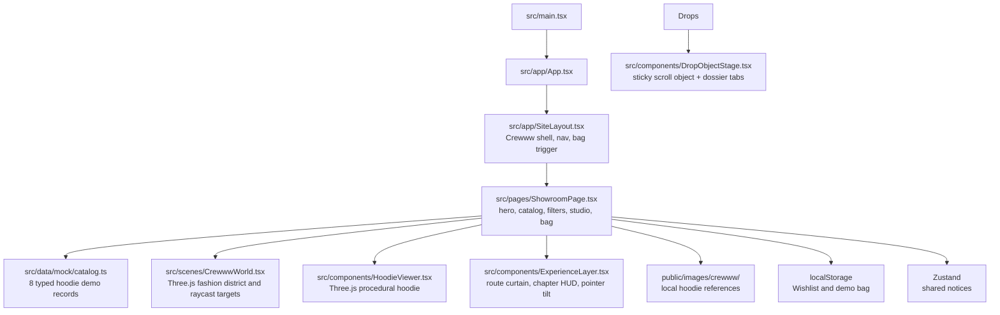

# Crewww Showroom Architecture

The storefront direction now follows the actual Crewww hoodie references supplied in `docs/material/`. The existing React, Vite, TypeScript, Router, query, Zustand, and CSS architecture is retained. The design is a branded hoodie capsule prototype, not a claim that the demo prices, size availability, or copy are approved commerce data.

## Application flow

The inspection studio stays inside the showroom route, preserving catalog filters, sort order, wishlist and scroll position. It records the selected card bounds for its open/close transition, pushes a `#inspection` history entry, and restores focus to the invoking card. The studio is a fixed, full-screen responsive overlay; the shopping bag is a fixed modal drawer with local persistence. Checkout is not connected. The hero world is a separate route-level scene. Its Three.js raycast targets and its DOM navigation links activate the same React collection destination.

## Product references and mock data boundary

Seventeen user-supplied JPGs are kept in `docs/material/` and copied into `public/images/crewww/hoodie-01.jpg` through `hoodie-17.jpg`. The first eight are currently displayed in the demo grid; the remaining references are kept local but are not assigned a confirmed product record yet. Product cards do not depend on third-party image hosts.

Product names describe visible artwork. Prices, currency, sizes, color variants, stock, material and care are provisional mock data and must be replaced or confirmed by Crewww before launch. Image metadata/UI marks present in some supplied reference photos are part of the source files. There is no backend, checkout, inventory reservation, or account sync.

## Three.js hoodie prototype

`CrewwwWorld` under `src/scenes/` is dynamically imported by the showroom and uses Three.js directly. It composes low-poly storefronts, road, lights, window displays, local product-photo billboards, destination signs and a suspended garment. Bounded pointer movement adjusts the camera; scroll moves the camera slightly along the block. Store sign meshes are raycast targets, with matching semantic DOM links for keyboard/touch/screen-reader access. `HoodieViewer` is a separate dynamic product-inspection scene. It builds a stylized hoodie silhouette from procedural extruded geometry with a hood, sleeves, cuffs, pouch pocket, cords and a generated Crewww chest graphic. Users can drag to rotate it, use rotate-left/right controls, and reset the view. The inspection viewer rebuilds its fabric color when a selected mock color changes and links to the supplied product reference image.

This is an illustrative interactive 3D prototype. It is not a scan or production garment model and does not reproduce the specific back prints, folds, stitching, proportions, fabric drape, or product photography. No GLB/GLTF model or product texture maps were supplied. A WebGL-unavailable fallback keeps product details and bag controls available and hides scene-only rotate controls. Rendering is on demand after setup/resize/input; there is no autoplay camera or scroll hijacking. Pixel ratio is capped at 1.5 and scene resources are disposed on unmount/color change.

## QA and transition behavior

- Search, category/collection/size/color/price/availability/new/bestseller filters, sorting and empty states operate on the typed local catalog.
- The studio supports browser Back, Escape, selection, quantity, wishlist, details, add-to-bag, focus containment and reduced-motion closing behavior.
- The bag supports persistence, distinct variant lines and removal; product availability is demo-only.
- Inspection studio and bag presentation are viewport overlays with narrow-screen layouts; reduced-motion preferences suppress their entry/exit animation.
- `playwright.config.ts` starts Vite on a strict fixed port and only reuses a server when `PW_REUSE_SERVER=1` is set. This prevents an unhealthy orphan listener from being mistaken for the test server.
- Global experience layer is `src/components/ExperienceLayer.tsx`: route-transition curtain, chapter HUD, pointer tilt, and scroll variables.
- `src/components/DropObjectStage.tsx` is the drop page’s sticky scroll object. It turns the included Three.js hoodie as the page scrolls, moves a dossier from concept to artwork to loadout, and exposes the parent page’s selected colourway/size/equip actions.
- Browser screenshots are recorded in `docs/visual-checks/` (for example `home-00.jpeg`, `drops-00.jpeg`, `drop-minds-00.jpeg`, `shop-00.jpeg`; legacy captures also remain as `crewww-home-*.png`). Key captures are at 360, 390, 768, 1024 and 1440 CSS pixels, including `crewww-home-*.png` and `psychedelic-room-*.png`.
- The object section is `data-chapter="THE OBJECT"`; use `VITE_INITIAL_ROUTE=/drops/psychedelic-minds` in Docker to start there.

## Remaining scope

This pass adapts the existing showroom to the supplied Crewww references and adds an immersive, stylized district entrance with a direct 2D shop path. The full M2 editorial homepage brief remains open: campaign/editorial sections, categories beyond hoodies, denim/kids/accessories/shoes, store discovery, newsletter and a complete content-led footer are not implemented. Production prices/variants/content, real garment models and texture licensing, a real product API, checkout, device-level WebGL performance review and broader end-to-end coverage remain unresolved. M3 has not started.
